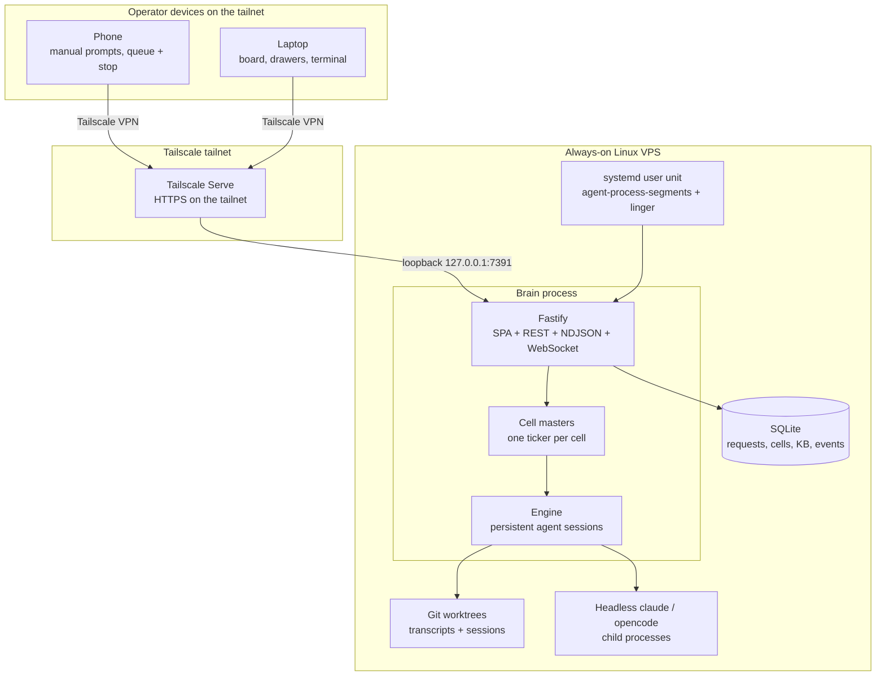
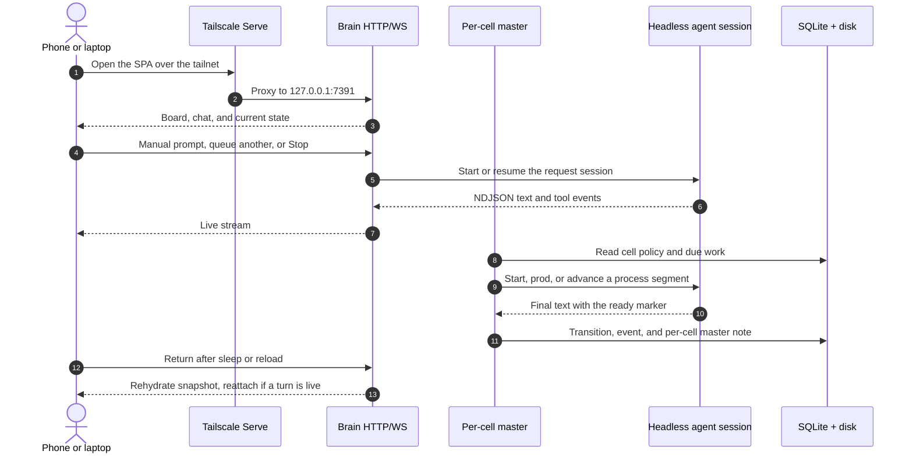
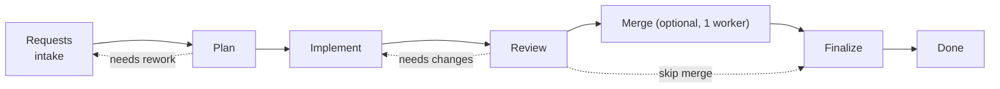
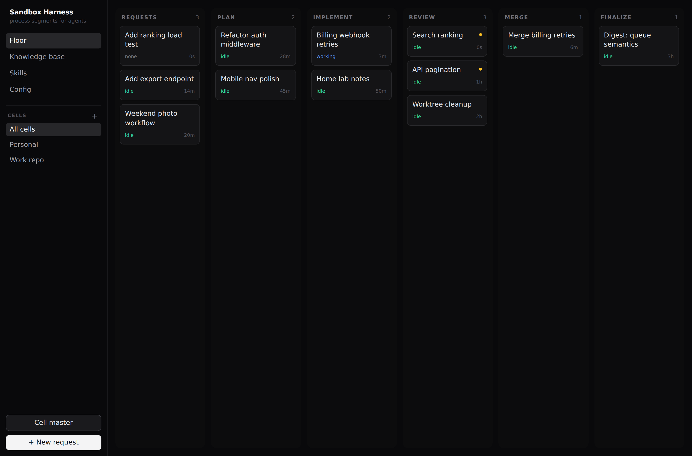
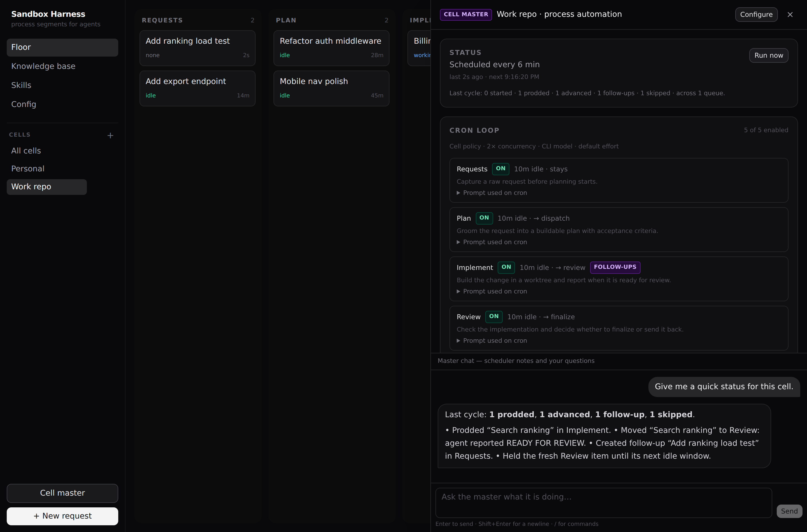

# Agent Process Segments

Formerly Sandbox Harness.

A local Node/TypeScript brain that drives headless Claude Code or OpenCode sessions
through a request workflow. One origin serves the API, an optional SPA, and the websocket, so a
single port is all a tunnel needs.

`Agent Process Segments` is the product name; a *process segment* is one stage in a
cell's pipeline.

This repository is a rebuild from the system spec at commit `f849fed`. It targets the
same data model, state machine, HTTP surface, and wire contracts.

## Intended deployment and user flow

The intended setup is one always-on Linux VPS running the headless brain and agent
processes, with the SPA exposed only through a Tailscale tailnet. A phone or laptop joins
the tailnet, opens the SPA, and sends manual prompts while the VPS keeps working. The
brain binds loopback; Tailscale Serve is the audience gate. On the VPS,
`sudo tailscale serve --bg --https=443 http://127.0.0.1:7391` publishes the loopback
port to the tailnet; only devices on that tailnet can reach it. The full install, HTTPS,
verification, and reset steps are in
[`deploy/vps.md#tailscale`](deploy/vps.md#tailscale).



Typical session flow:



The phone is a controller, not the worker. It can disconnect, reload, or queue a prompt;
the VPS keeps the session and the per-cell masters keep running. A request moves through:



The deployment runbook is in [`deploy/vps.md`](deploy/vps.md); the operator workflow is
in [`docs/08-user-workflows.md`](docs/08-user-workflows.md).

## Screens

The board is the main loop: five process segments, cell filters, agent status, and
unchecked-work markers. The drawer is the selected cell’s master: status, cron loop,
prompts, scorecard, activity, and chat.

These screenshots use a staged demo board in an isolated temp database, not live data.
Regenerate them against the built SPA with the optional Puppeteer tool:

```bash
npm run build
npm install --no-save puppeteer
npx puppeteer browsers install chrome
node scripts/screenshots.mjs
```





The **Usage** page shows reported cost and, for turns a harness left unpriced, estimates
from the operator-maintained **Model pricing** table on the Config page. Reported cost is
never overwritten; a turn with neither a reported cost nor an effective price renders as
unknown or as an explicit lower bound, never as zero.

## Requirements

- Node 22.13 or newer (Vite 8 and Vitest 5 already need 22.12; ESLint 10 needs 22.13).
- `git` for per-request worktrees
- `claude` and/or `opencode` on `PATH` to run real agent turns. `APS_HARNESS` picks the
  brain default (legacy `SBOX_HARNESS` still works), and each cell can override it, so one
  brain can mix both. The core (database, workflows, HTTP, stream parsing) runs and is
  tested without an agent CLI.

## Quick start

```bash
npm install
npm test
npm run e2e
npm run build
APS_DB=$PWD/agent-process-segments.sqlite node src/server/dist/app.js
```

The brain binds `127.0.0.1:7391` unless `APS_HOST` / `APS_PORT` say otherwise. Do not
widen the bind. A tunnel is the audience gate, not the process.

The sidebar **Help** row renders the operator docs in-app from the same origin, including
the screenshots, with grouped navigation and `?help=<slug>` deep links. A GitHub icon
beside it links to the public source repository in a new tab. The brain reads the docs
from `APS_DOCS_DIR` (default `<cwd>/docs`), so ship the `docs/` directory beside the
build.

Agent turns are bounded by `APS_TURN_TIMEOUT_MS` (default ten minutes); a live but silent
child is killed and produces a visible error, and its recent stderr goes to the error log.
A harness-reported error result (for example expired authentication or a rate limit) also
fails the turn with a visible `⚠` message instead of ending silently. Bundled `aps` MCP
calls time out after `APS_MCP_TIMEOUT_MS` (default 15 seconds).

`APS_HARNESS=claude` (the default) or `opencode` sets the brain default. Each cell can
choose its own harness in the cell editor; a cell with **Brain default** inherits this
value. A request can override its cell in the request drawer; the order is request,
then cell, then brain default. A cross-harness request does not inherit the cell's model
or effort, because those ids were chosen for the other adapter. `APS_CLAUDE_BIN` and
`APS_OPENCODE_BIN` point at each adapter's binary; `APS_HARNESS_BIN` remains a legacy
fallback for the default adapter only, and the adapter-specific value wins when both are
set. The legacy `SBOX_*` names still work. `APS_DEFAULT_MODEL` sets the default harness's
fallback model. OpenCode also has an implicit `opencode-go/deepseek-v4.1-flash` default;
Claude has none unless configured.

Usage retention lives in `config.json` as `usage.retentionDays` and is editable from the
Config page. The default is 90 days; `0` keeps raw usage history forever. Before raw
`usage_events` rows are deleted, a startup/hourly job summarizes them into `usage_daily`
UTC-day rollups, then prunes the raw rows in batches. "All time" therefore includes both
the retained raw window and older daily totals. Once a day is rolled up its estimated
cost is frozen, and raising the window later cannot restore already-pruned raw detail.
Cost reported by the harness always wins; only unreported turns are estimated.

Master activity retention lives in `config.json` as `retention.masterEventsDays`, also
editable from the Config page. The default is 90 days; `0` keeps activity forever. A
startup/hourly job deletes older `master_events` rows in batches. Activity is not rolled
up: the UI reads only the latest events, and scorecard history stays in `cell_summaries`.
Rows that record a created follow-up (`action = 'followup'`) are never pruned, because
they are the deduplication key for repeated `FOLLOW-UP:` titles. Deleting a cell
immediately removes its non-followup activity and its reserved master and summary session
directories; the follow-up markers survive so detached requests keep their dedupe history.

Request artifact retention lives in `config.json` as `retention.requestArtifactsDays`,
also editable from the Config page. The default is 30 days; `0` keeps request folders and
worktrees forever. A startup/hourly job deletes the whole
`$APS_DATA_DIR/requests/<id>/` workdir (transcripts, session id, generated config, and
scratch `cwd`) and removes leftover `$APS_DATA_DIR/worktrees/<id>` checkouts, but only for
`done` or `dropped` requests older than the window. Non-terminal requests, live turns,
reserved master/summary/setup/KB chats, and non-request folders are never touched. Git
branches are kept; uncommitted work in an expired checkout is discarded, as it already is
on a normal terminal dispose.

`./scripts/smoke.sh` boots the built server on a throwaway database and exercises the
main routes over a real socket.

## Upgrading from Sandbox Harness

`APS_*` is the canonical environment prefix. Every legacy `SBOX_*` variable still works
as a fallback, and `APS_*` wins when both are set. The fallback is per variable: if you set
`APS_HARNESS` while an old `SBOX_HARNESS_BIN` is still exported, the old binary path wins
for `HARNESS_BIN`; set `APS_HARNESS_BIN` (or unset the legacy value) when switching
harnesses. Filesystem defaults are also backward-compatible: if only `~/.sandbox-harness`,
`$XDG_CONFIG_HOME/sandbox-harness`, `$XDG_STATE_HOME/sandbox-harness`, or
`<cwd>/sandbox-harness.sqlite` exists, the brain keeps using it. New installs get the
`agent-process-segments` names.

A brain started with any `SBOX_*` variable still set logs one warning naming those
variables (names only, never values). Rename them to `APS_*` to clear it;
`npm run migrate:paths` moves only the filesystem defaults, not the variable names.

The migration refuses to run while `agent-process-segments.service` or the legacy
`sandbox-harness.service` is active (user or system scope). Stop the unit first;
`--allow-running` bypasses the guard and can corrupt an open SQLite database. A
foreground/dev brain or a custom unit name is not detected.

To move an existing install to the new names:

1. Stop the old unit: `systemctl --user stop sandbox-harness`.
2. Preview then run the move: `npm run migrate:paths -- --dry-run` and
   `npm run migrate:paths`. The script moves the data, config, and state directories and
   the SQLite file together, including `-wal`/`-shm`; it never overwrites an existing
   destination and is safe to re-run.
3. Install the new unit: copy `deploy/agent-process-segments.service` into
   `~/.config/systemd/user/`, then `systemctl --user daemon-reload` and
   `systemctl --user enable --now agent-process-segments`.

Worktree branches created before the rebrand are named `sbox/<id>`. They stay valid
until the request finishes; once nothing is in flight, retire them with:

```
npm run build                       # the command runs from dist
npm run migrate:branches -- --dry-run
npm run migrate:branches -- --apply
```

The command renames a lone `sbox/<id>` to `aps/<id>`, deletes the legacy ref when it is
already contained in `aps/<id>`, and repairs a stored branch whose legacy ref is gone.
It never touches a branch for a request that is not `done`/`dropped`, a branch checked
out in any worktree, or a diverged `sbox`/`aps` pair (those are reported for manual
review). Orphan `sbox/*` refs with no request row are report-only. Pass `--repo DIR` to
limit the run and `--db FILE` to point at a non-default database.

Do not install the new unit before migrating: it sets explicit `APS_*` paths, so the
brain would open empty new locations. Existing worktrees move with the data directory; if
git reports them at the old path, run `git worktree repair` in the target repo or remove
and recreate them.

Rollback is manual: an older binary reads only `SBOX_*`, so a rollback unit or drop-in
must point `SBOX_DB`, `SBOX_DATA_DIR`, `SBOX_CONFIG`, and the other path variables at the
migrated locations.

On a running host, especially one whose brain is orchestrating its own cutover, use
`npm run cutover:vps -- --dry-run` and then `--detach` instead of the manual sequence.
The script drains active turns, moves the clone and paths, repairs worktrees, verifies
the new unit, and rolls back in place on failure. See
[`deploy/vps.md`](deploy/vps.md#cutting-over-a-live-self-hosted-brain).

Each cutover leaves evidence and a rollback backup under `~/.aps-cutover/runs/`. Prune
old runs with `npm run prune:cutover -- --dry-run` and then `npm run prune:cutover`; see
[`deploy/vps.md`](deploy/vps.md#prune-cutover-run-directories-and-backups).

## Spend budgets

The Config page edits an **overall monthly budget** and warning percentage; each cell has
an optional monthly budget in its editor. Budgets use the UTC calendar month. Alerts use
harness-reported `cost_usd`; unpriced turns are shown as unknown or a lower bound, never as
zero. Crossing the warning percentage or the budget creates a durable alert shown in a
dismissible banner; acknowledging it silences that alert for the month.

Each scope can also opt into **pause on exceeded**. A hard cap counts reported plus
estimated cost, pauses new work at the cap, and leaves in-flight turns alone. Overall
pauses every new agent turn; a cell pause affects only that cell's request, master, and
summary work. Raise or clear the budget, turn the option off, or wait for the UTC month to
roll over to resume. Acknowledging an alert does not override a pause. The same cap spend
and pause state are shown on the Config and Usage pages and in the app banner. The Usage
card and banner share one budget poll; the card keeps its last good status when a refresh
fails and offers Retry when budget status cannot be loaded.

## Alert delivery

The Config page's **Alert delivery** card sends each unacknowledged current-month alert
once to an opt-in HTTPS webhook. Formats are `json` (the full event, signed with
HMAC-SHA256), `slack` (`{ "text": … }`), and `discord` (`{ "content": … }`). Delivery is
durable: `budget_alert_deliveries` stores one row per alert and channel, retries transient
failures at 60 s, 5 min, 30 min, and 2 h up to five attempts, honors `Retry-After`, and
never blocks budgets, turns, or the in-app banner. Acknowledging an alert, changing the
budget or threshold, or changing the destination skips pending deliveries. JSON requests
carry `X-APS-Signature: sha256=<hex>` (HMAC over the raw body) plus an
`X-APS-Timestamp`; Slack and Discord ignore both headers.

The independent **Email delivery** card adds SMTP as a second channel. Set a host, port,
optional username and password, `From` address, and up to ten recipients. Port 465 uses
implicit TLS; other ports require STARTTLS for any non-loopback host. Email and webhook
rows share the same outbox and retry schedule but dedupe per channel, so disabling or
re-pointing one channel never cancels the other. A saved password is redacted from the API
and only cleared when the operator asks.

`GET /api/notifications/status` shows per-channel queue, failure, and last-delivery state.
`POST /api/notifications/webhook/test` and `POST /api/notifications/email/test` send
synthetic test events without writing alert or delivery rows. Native chat bots, per-cell
routing, and delivery history remain separate backlog items.

## Docs

- `docs/01-system-spec.md` the governing contract
- `docs/02-status.md` built versus not built, route list, deviations
- `docs/03-decisions.md` why this rebuild chose what it chose
- `docs/04-design-liberties.md` autonomous choices to review
- `docs/05-plan.md` current feature plan and task list
- `docs/06-refactor-audit.md` duplication/bug audit and deferred cleanup
- `docs/07-process-segments.md` process.json contract and automation rules
- `docs/08-user-workflows.md` end-to-end operator workflows
- `docs/09-backlog.md` scoped follow-ups (email/chat channels, hard-cap refinements, pricing maintenance)
- `docs/10-error-log.md` error-only NDJSON log: path, format, rotation, sites
- `docs/11-skills.md` chat slash-command and skill discovery
- `docs/12-terminals.md` server-owned PTY sessions, reattach, and close
- `docs/13-cell-wizard.md` cell creation chat and policy setup
- `deploy/vps.md` VPS, systemd, and Tailscale runbook
- `AGENTS.md` handoff: environment traps, invariants, extension recipes, next units

## Layout

```
src/server/src
  app.ts              entry: open db, build repos + engine, listen
  config.ts           every path and port, env-overridable
  db.ts               schema, idempotent column migrations, boot reconcile
  domain/request.ts   states, transition table, entities, transcript types
  domain/sessions.ts  reserved KB/master session ids, per-cell master sessions
  domain/budget.ts    pure budget contract: settings, UTC month, status, alert types
  requests/           RequestRepository: CRUD, edit, guarded transitions
  cells/              CellRepository + in-memory cell wizard drafts; per-cell policy,
                      interval, concurrency cap, model/effort defaults, auto-compaction
                      threshold, and budget
  usage/              ledger queries, budget status/alerts, and durable webhook/email delivery
  kb/                 KbRepository: one entry per request, ranked literal search
  http/server.ts      Fastify routes, zod validation, NDJSON streaming, SPA vend
  clarify/engine.ts   one persistent agent session per request, buffered live turns
  clarify/harness.ts  harness seam: session prep, spawn, parser, model probe
  clarify/harnesses/claude.ts    claude CLI, merged MCP config, allowlist
  clarify/harnesses/opencode.ts  opencode CLI, per-turn runs, session resume
  clarify/harnesses/plugin-assets.ts  plugin skills/commands -> OpenCode config
  clarify/stream.ts   pure claude stream-json parser (no process, no disk)
  clarify/transport.ts  the AgentProcess interface harnesses implement
  clarify/prompts.ts  seed, dispatch, finalize, and KB briefs
  clarify/worktree.ts per-request git worktree on branch aps/<id> (legacy sbox/<id> reused)
  clarify/models.ts   model catalog with a cached probe and harness fallback
  settings.ts         XDG scheduler settings, zod validation, atomic write
  docs/service.ts     explicit Help manifest, Markdown reads, screenshot assets
  process/            six segment definitions (incl. Merge), defaults, store, follow-up parser
  master/events.ts    master event log (start, prod, advance, followup, cycle, skip)
  master/service.ts   one master bucket: segments, follow-ups, advancement, cell chat
  master/scheduler.ts per-cell timers, per-cell manual run, one dispatch cycle per cell
  summary/            per-cell scorecard policy, deterministic stats, read-only generation,
                      polling scheduler, persisted report history
  mcp/server.ts       stdio `aps` MCP server exposing harness tools, proxied to the API
  mcp/identity.ts     shared MCP server key, tool prefix, and allow-list helper
  skills/catalog.ts   OpenCode/Claude skill discovery, global + project + request repo
  usage/types.ts      pure usage contract shared with the SPA
  usage/repository.ts usage_events writes plus merged raw/daily queries
  usage/sql.ts        shared price/estimate SQL and raw+daily query source
  usage/rollups.ts    UTC-day rollup writer and watermark
  usage/retention.ts  chunked rollup-then-prune job
  pricing/types.ts    pure effective-dated price contract and estimate helper
  pricing/repository.ts model_pricing list/create/remove plus effective lookup
  logging/errors.ts   structured error-only NDJSON log with size rotation
  terminal/service.ts server-owned PTY sessions with scrollback + attach/detach
  plugins/manager.ts  install, strip hooks/mcp, list, remove, slash-command discovery
src/web
  vite.config.ts      dev server, proxying /api and /ws to the brain
  src/main.tsx        mounts the app and turns on the dark class
  src/App.tsx         shell: nav, cell bar, board, usage page, detail drawer, Help route
  src/HelpPanel.tsx   full-height docs overlay: nav rail, markdown, on-this-page
  src/docs.ts         help slugs, relative link/image rewriting, heading anchors
  src/Board.tsx       six columns, drag-to-advance, agent badges
  src/UsagePage.tsx   overall/cell usage dashboard, reported/estimated cost chart
  src/usageFormat.ts  token/cost formatters with exact/≈/≥ cost distinction
  src/RequestDetail.tsx  edit fields, guarded transitions, kickoff streams, usage, digest
  src/ClarifyChat.tsx    per-request chat, reattach on mount
  src/Thread.tsx      assistant-ui primitives, markdown, tool cards
  src/runtime.ts      useExternalStoreRuntime over React-owned messages
  src/Composer.tsx    custom input with slash-command autocomplete
  src/ConfigPage.tsx  scheduler, budgets/alert delivery, process editor, pricing, policy
  src/BudgetBanner.tsx dismissible warning/exceeded spend alerts
  src/ProcessEditor.tsx structured per-segment controls
  src/CellModal.tsx   cell creation/edit flow with a process snapshot and budget
  src/MasterDetail.tsx first-class master drawer: status, prompts, activity, chat
  src/TerminalPanel.tsx desktop-only maximizable xterm/PTY drawer
  src/ui.tsx          hand-rolled shadcn-style kit
deploy
  agent-process-segments.service  systemd user unit for the brain
  vps.md                   install, tunnel, update, and restart runbook
  ci-workflow.yml          ready GitHub Actions workflow (needs workflow scope)
```

## API

All JSON except the NDJSON streams. See `docs/02-status.md` for the route list and
what is not built yet.

## Tests

`npm test` runs 684 vitest cases: 507 server cases (state machine, migrations including
the index ordering fix on a legacy database, repositories, both stream parsers, usage
event capture and aggregation, effective-dated pricing and estimation, usage rollups and
activity retention, cell-delete activity and session cleanup, request-artifact and worktree
retention, cutover run retention, engine
turns over a fake harness, worktree isolation against a real
git repo, the MCP tool surface, harness
config/MCP/plugin mapping, model probing, the plugin manager against real git clones,
process definitions/store/follow-ups, per-cell policies/tickers/limits/auto-compaction,
the generic master pipeline, segment caps and merge, turn watchdogs/stderr, scorecard
stats/generation/scheduling, budget status/alerts/hard caps, webhook delivery
dedupe/retry/signing with an injected sender, docs manifest/traversal/HTTP, error-log
format/rotation, skill discovery, terminal session lifecycle, and the HTTP API over a real
socket) and 177 web cases (shared contract re-exports, NDJSON client, chat folding,
slash/skill resolution, request-form mapping, docs helpers and Help overlay, the source
link, board, create modal, composer, cell bar, cell creation, config/process and pricing
editor, budget and alert-delivery cards, budget banner, master detail and scorecard, the
usage page and formatters, and the app shell with the drawer and chat mounted under jsdom).

`npm test` also runs `npm run test:e2e-env`, a `node:test` guard for the environments the
proof scripts hand to their children; it is not counted in the vitest totals.

`npm run lint` runs ESLint 10 over `src/**/*.{ts,tsx}` from one flat config
(`eslint.config.mjs`) in both workspaces, with the classic React hook rules for the SPA,
and fails on any warning.

`node scripts/mcp-smoke.mjs` is the stronger check: it boots the built brain, spawns
the built MCP server over stdio, proves a tool call persists through the API into
SQLite, and fails if any round trip or persisted value does not match.

`node scripts/claude-mock-smoke.mjs` verifies the real Claude Code binary against a local
mock Anthropic API: a streamed turn, an MCP tool round-trip, resumed session, and a
probed model catalog. It runs with a hermetic child env and pins the legacy `SBOX_*`
aliases on purpose. It skips when no `claude` binary is available.

`npm run e2e` boots the built brain on a temp DB with a deterministic mock Claude CLI,
creates a dedicated `E2E` cell, and exercises clarify → dispatch → master prod/review →
follow-up creation → per-cell master chat → concurrency cap → finalize. It never indexes
into the KB; the suite asserts the KB stays empty. It uses no live data and cleans up the
temp directory. The JavaScript proof scripts build their child env with
`scripts/e2e/env.mjs` (`scrubEnv` + `buildPinnedEnv`): host `APS_*`/`SBOX_*` settings and
`ANTHROPIC_*`/`CLAUDE_*`/`OPENAI_*` credentials are dropped, then each script's paths,
port, harness, and mock binary are pinned. The Claude and MCP smokes keep deliberate
`SBOX_*` pins so the legacy aliases stay under test. A shell that exports harness
overrides therefore still exercises the mock.

CI runs that E2E step with hostile overrides exported (`SBOX_HARNESS_BIN=/bin/false`,
`APS_HARNESS=opencode`, `APS_TURN_TIMEOUT_MS=1`, and similar), so a regression that lets
the host env through fails the build. Reproduce it locally after building:

```bash
npm run build
env SBOX_HARNESS_BIN=/bin/false APS_HARNESS=opencode APS_TURN_TIMEOUT_MS=1 \
  node scripts/e2e.mjs
```

`node scripts/ui-smoke.mjs` is an optional real-browser check. Install Puppeteer first
(`npm install --no-save puppeteer && npx puppeteer browsers install chrome`), point
`UI_BASE` at a running brain, then run it. It creates and drops a request, opens the
drawer/chat, visits the KB and Config pages, and fails on page errors. `UI_MOBILE=1`
runs the same flow at 390×844 with the off-canvas menu checks. It skips when Puppeteer
is absent.

`node scripts/screenshots.mjs` uses the same optional Puppeteer install to rebuild
`docs/screenshots/board.png` and `docs/screenshots/master.png` from a staged temp board.
It needs `npm run build` first and skips when Puppeteer is absent.

CI (`deploy/ci-workflow.yml`) runs lint, typecheck, the full test suite, the build, the
E2E API workflow, and the HTTP/MCP smoke scripts on pushes and pull requests. Copy it to
`.github/workflows/ci.yml` with a credential that has the `workflow` scope to activate
it.
