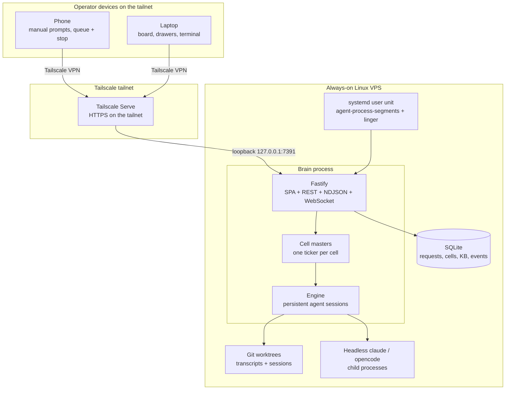
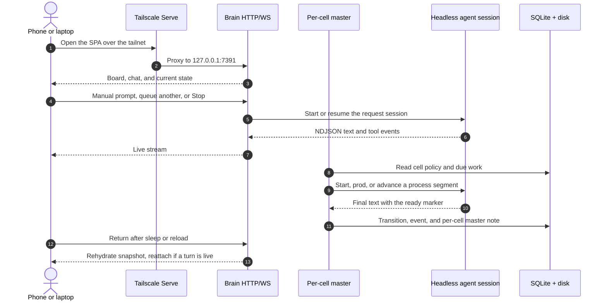
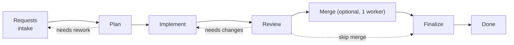

# Agent Process Segments

Formerly Sandbox Harness.

A local Node/TypeScript brain that drives headless Claude Code or OpenCode sessions
through a request workflow. One origin serves the API, an optional SPA, and the websocket, so a
single port is all a tunnel needs.

`Agent Process Segments` is the product name; a *process segment* is one stage in a
cell's pipeline.

This repository is a rebuild from the system spec at commit `f849fed`. It targets the
same data model, state machine, HTTP surface, and wire contracts.

## Intended deployment and user flow

The intended setup is one always-on Linux VPS running the headless brain and agent
processes, with the SPA exposed only through a Tailscale tailnet. A phone or laptop joins
the tailnet, opens the SPA, and sends manual prompts while the VPS keeps working. The
brain binds loopback; Tailscale Serve is the audience gate. On the VPS,
`sudo tailscale serve --bg --https=443 http://127.0.0.1:7391` publishes the loopback
port to the tailnet; only devices on that tailnet can reach it. The full install, HTTPS,
verification, and reset steps are in
[`deploy/vps.md#tailscale`](deploy/vps.md#tailscale).



Typical session flow:



The phone is a controller, not the worker. It can disconnect, reload, or queue a prompt;
the VPS keeps the session and the per-cell masters keep running. A request moves through:



The deployment runbook is in [`deploy/vps.md`](deploy/vps.md); the operator workflow is
in [`docs/08-user-workflows.md`](docs/08-user-workflows.md).

## Screens

The board is the main loop: five process segments, cell filters, agent status, and
unchecked-work markers. The drawer is the selected cell’s master: ticker, cron loop,
prompts, activity, and chat.

These screenshots use a staged demo board in an isolated temp database, not live data.


## Requirements

- Node 20 or newer
- `git` for per-request worktrees
- `claude` and/or `opencode` on `PATH` to run real agent turns. `APS_HARNESS` picks the
  brain default (legacy `SBOX_HARNESS` still works), and each cell can override it, so one
  brain can mix both. The core (database, workflows, HTTP, stream parsing) runs and is
  tested without an agent CLI.

## Quick start

```bash
npm install
npm test
npm run e2e
npm run build
APS_DB=$PWD/agent-process-segments.sqlite node src/server/dist/app.js
```

The brain binds `127.0.0.1:7391` unless `APS_HOST` / `APS_PORT` say otherwise. Do not
widen the bind. A tunnel is the audience gate, not the process.

The sidebar **Help** row renders the operator docs in-app from the same origin, including
the screenshots, with grouped navigation and `?help=<slug>` deep links. A GitHub icon
beside it links to the public source repository in a new tab. The brain reads the docs
from `APS_DOCS_DIR` (default `<cwd>/docs`), so ship the `docs/` directory beside the
build.

Agent turns are bounded by `APS_TURN_TIMEOUT_MS` (default ten minutes); a live but silent
child is killed and produces a visible error, and its recent stderr goes to the error log.
Harness MCP calls time out after `APS_MCP_TIMEOUT_MS` (default 15 seconds).

`APS_HARNESS=claude` (the default) or `opencode` sets the brain default. Each cell can
choose its own harness in the cell editor; a cell with **Brain default** inherits this
value. `APS_CLAUDE_BIN` and `APS_OPENCODE_BIN` point at each adapter's binary;
`APS_HARNESS_BIN` remains a legacy fallback for the default adapter only, and the
adapter-specific value wins when both are set. The legacy `SBOX_*` names still work.
`APS_DEFAULT_MODEL` sets the default harness's fallback model. OpenCode also has an
implicit `opencode-go/deepseek-v4.1-flash` default; Claude has none unless configured.

Usage retention lives in `config.json` as `usage.retentionDays` and is editable from the
Config page. The default is 90 days; `0` keeps usage history forever. Raw
`usage_events` rows older than the window are deleted shortly after startup and then
hourly in small batches, so all-time usage totals cover the retained window. Cost is
reported by the harness, never estimated.

`./scripts/smoke.sh` boots the built server on a throwaway database and exercises the
main routes over a real socket.

## Upgrading from Sandbox Harness

`APS_*` is the canonical environment prefix. Every legacy `SBOX_*` variable still works
as a fallback, and `APS_*` wins when both are set. The fallback is per variable: if you set
`APS_HARNESS` while an old `SBOX_HARNESS_BIN` is still exported, the old binary path wins
for `HARNESS_BIN`; set `APS_HARNESS_BIN` (or unset the legacy value) when switching
harnesses. Filesystem defaults are also backward-compatible: if only `~/.sandbox-harness`,
`$XDG_CONFIG_HOME/sandbox-harness`, `$XDG_STATE_HOME/sandbox-harness`, or
`<cwd>/sandbox-harness.sqlite` exists, the brain keeps using it. New installs get the
`agent-process-segments` names.

To move an existing install to the new names:

1. Stop the old unit: `systemctl --user stop sandbox-harness`.
2. Preview then run the move: `npm run migrate:paths -- --dry-run` and
   `npm run migrate:paths`. The script moves the data, config, and state directories and
   the SQLite file together, including `-wal`/`-shm`; it never overwrites an existing
   destination and is safe to re-run.
3. Install the new unit: copy `deploy/agent-process-segments.service` into
   `~/.config/systemd/user/`, then `systemctl --user daemon-reload` and
   `systemctl --user enable --now agent-process-segments`.

Do not install the new unit before migrating: it sets explicit `APS_*` paths, so the
brain would open empty new locations. Existing worktrees move with the data directory; if
git reports them at the old path, run `git worktree repair` in the target repo or remove
and recreate them.

Rollback is manual: an older binary reads only `SBOX_*`, so a rollback unit or drop-in
must point `SBOX_DB`, `SBOX_DATA_DIR`, `SBOX_CONFIG`, and the other path variables at the
migrated locations.

## Spend budgets

The Config page edits an advisory **overall monthly budget** and warning percentage; each
cell has an optional monthly budget in its editor. Budgets use the UTC calendar month and
only harness-reported `cost_usd`. Unpriced turns are shown as unknown or a lower bound,
never as zero or a guessed estimate. Crossing the warning percentage or the budget creates
a durable alert shown in a dismissible banner; acknowledging it silences that alert for the
month. Budgets never pause or block work.

The budget layer reads totals from the usage repository and is shown on both the Config
page and the Usage page. Hard spend caps, long-range rollups, and external notification
delivery are separate backlog items.

## Docs

- `docs/01-system-spec.md` the governing contract
- `docs/02-status.md` built versus not built, route list, deviations
- `docs/03-decisions.md` why this rebuild chose what it chose
- `docs/04-design-liberties.md` autonomous choices to review
- `docs/05-plan.md` current feature plan and task list
- `docs/06-refactor-audit.md` duplication/bug audit and deferred cleanup
- `docs/07-process-segments.md` process.json contract and automation rules
- `docs/08-user-workflows.md` end-to-end operator workflows
- `docs/09-backlog.md` scoped follow-ups (long-range rollups, hard budget caps, pricing)
- `docs/10-error-log.md` error-only NDJSON log: path, format, rotation, sites
- `docs/11-skills.md` chat slash-command and skill discovery
- `docs/12-terminals.md` server-owned PTY sessions, reattach, and close
- `docs/13-cell-wizard.md` cell creation chat and policy setup
- `deploy/vps.md` VPS, systemd, and Tailscale runbook
- `AGENTS.md` handoff: environment traps, invariants, extension recipes, next units

## Layout

```
src/server/src
  app.ts              entry: open db, build repos + engine, listen
  config.ts           every path and port, env-overridable
  db.ts               schema, idempotent column migrations, boot reconcile
  domain/request.ts   states, transition table, entities, transcript types
  domain/sessions.ts  reserved KB/master session ids, per-cell master sessions
  domain/budget.ts    pure budget contract: settings, UTC month, status, alert types
  requests/           RequestRepository: CRUD, edit, guarded transitions
  cells/              CellRepository + in-memory cell wizard drafts; per-cell policy,
                      interval, concurrency cap, model/effort defaults, and budget
  usage/              usage ledger queries plus budget status and durable alerts
  kb/                 KbRepository: one entry per request, ranked literal search
  http/server.ts      Fastify routes, zod validation, NDJSON streaming, SPA vend
  clarify/engine.ts   one persistent agent session per request, buffered live turns
  clarify/harness.ts  harness seam: session prep, spawn, parser, model probe
  clarify/harnesses/claude.ts    claude CLI, merged MCP config, allowlist
  clarify/harnesses/opencode.ts  opencode CLI, per-turn runs, session resume
  clarify/harnesses/plugin-assets.ts  plugin skills/commands -> OpenCode config
  clarify/stream.ts   pure claude stream-json parser (no process, no disk)
  clarify/transport.ts  the AgentProcess interface harnesses implement
  clarify/prompts.ts  seed, dispatch, finalize, and KB briefs
  clarify/worktree.ts per-request git worktree on branch aps/<id> (legacy sbox/<id> reused)
  clarify/models.ts   model catalog with a cached probe and harness fallback
  settings.ts         XDG scheduler settings, zod validation, atomic write
  docs/service.ts     explicit Help manifest, Markdown reads, screenshot assets
  process/            six segment definitions (incl. Merge), defaults, store, follow-up parser
  master/events.ts    master event log (start, prod, advance, followup, cycle, skip)
  master/service.ts   one master bucket: segments, follow-ups, advancement, cell chat
  master/scheduler.ts per-cell timers, per-cell manual run, coalesced cycles
  summary/            per-cell scorecard policy, deterministic stats, read-only generation,
                      polling scheduler, persisted report history
  mcp/server.ts       stdio MCP server exposing harness tools, proxied to the API
  skills/catalog.ts   OpenCode/Claude skill discovery, global + project + request repo
  usage/types.ts      pure usage contract shared with the SPA
  usage/repository.ts usage_events writes plus totals/series/group queries
  logging/errors.ts   structured error-only NDJSON log with size rotation
  terminal/service.ts server-owned PTY sessions with scrollback + attach/detach
  plugins/manager.ts  install, strip hooks/mcp, list, remove, slash-command discovery
src/web
  vite.config.ts      dev server, proxying /api and /ws to the brain
  src/main.tsx        mounts the app and turns on the dark class
  src/App.tsx         shell: nav, cell bar, board, usage page, detail drawer, Help route
  src/HelpPanel.tsx   full-height docs overlay: nav rail, markdown, on-this-page
  src/docs.ts         help slugs, relative link/image rewriting, heading anchors
  src/Board.tsx       six columns, drag-to-advance, agent badges
  src/UsagePage.tsx   overall/cell usage dashboard and breakdown tables
  src/usageFormat.ts  token/cost formatters that keep unknown cost distinct
  src/RequestDetail.tsx  edit fields, guarded transitions, kickoff streams, usage, digest
  src/ClarifyChat.tsx    per-request chat, reattach on mount
  src/Thread.tsx      assistant-ui primitives, markdown, tool cards
  src/runtime.ts      useExternalStoreRuntime over React-owned messages
  src/Composer.tsx    custom input with slash-command autocomplete
  src/ConfigPage.tsx  scheduler + budgets + global process editor + cell policy entries
  src/BudgetBanner.tsx dismissible warning/exceeded spend alerts
  src/ProcessEditor.tsx structured per-segment controls
  src/CellModal.tsx   cell creation/edit flow with a process snapshot and budget
  src/MasterDetail.tsx first-class master drawer: status, prompts, activity, chat
  src/TerminalPanel.tsx desktop-only maximizable xterm/PTY drawer
  src/ui.tsx          hand-rolled shadcn-style kit
deploy
  agent-process-segments.service  systemd user unit for the brain
  vps.md                   install, tunnel, update, and restart runbook
  ci-workflow.yml          ready GitHub Actions workflow (needs workflow scope)
```

## API

All JSON except the NDJSON streams. See `docs/02-status.md` for the route list and
what is not built yet.

## Tests

`npm test` runs 377 vitest cases: 264 server cases (state machine, migrations including
the index ordering fix on a legacy database, repositories, both stream parsers, usage
event capture and aggregation, engine turns over a fake harness, worktree isolation
against a real git repo, the MCP tool surface, harness config/MCP/plugin mapping, model
probing, the plugin manager against real git clones, process definitions/store/follow-ups,
per-cell policies/tickers/limits, the generic master pipeline, segment caps and merge,
turn watchdogs/stderr, scorecard stats/generation/scheduling, budget status/alerts, docs
manifest/traversal/HTTP, error-log format/rotation, skill discovery, terminal session
lifecycle, and the HTTP API over a real socket) and 113 web cases (shared contract
re-exports, NDJSON client, chat folding, slash/skill resolution, request-form mapping,
docs helpers and Help overlay, the source link, board, create modal, composer, cell bar,
cell creation, config/process editor, budget banner, master detail and scorecard, the
usage page and formatters, and the app shell with the drawer and chat mounted under
jsdom).

`node scripts/mcp-smoke.mjs` is the stronger check: it boots the built brain, spawns
the built MCP server over stdio, and proves a tool call persists through the API into
SQLite.

`node scripts/claude-mock-smoke.mjs` verifies the real Claude Code binary against a local
mock Anthropic API: a streamed turn, an MCP tool round-trip, resumed session, and a
probed model catalog. It skips when no `claude` binary is available.

`npm run e2e` boots the built brain on a temp DB with a deterministic mock Claude CLI,
creates a dedicated `E2E` cell, and exercises clarify → dispatch → master prod/review →
follow-up creation → per-cell master chat → concurrency cap → finalize. It never indexes
into the KB; the suite asserts the KB stays empty. It uses no live data and cleans up the
temp directory.

`node scripts/ui-smoke.mjs` is an optional real-browser check. Install Puppeteer first
(`npm install --no-save puppeteer && npx puppeteer browsers install chrome`), point
`UI_BASE` at a running brain, then run it. It creates and drops a request, opens the
drawer/chat, visits the KB and Config pages, and fails on page errors. `UI_MOBILE=1`
runs the same flow at 390×844 with the off-canvas menu checks. It skips when Puppeteer
is absent.

CI (`deploy/ci-workflow.yml`) runs typecheck, the full test suite, the build, the E2E
API workflow, and the HTTP/MCP smoke scripts on pushes and pull requests. Copy it to
`.github/workflows/ci.yml` with a credential that has the `workflow` scope to activate
it.
