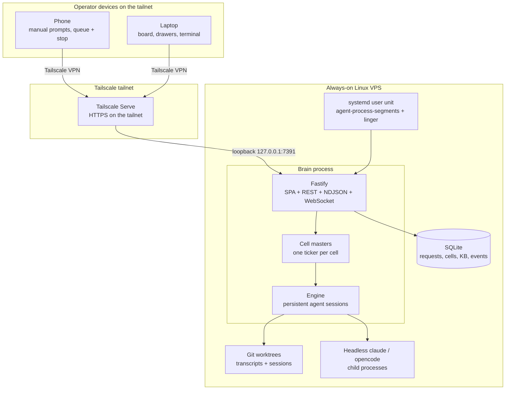
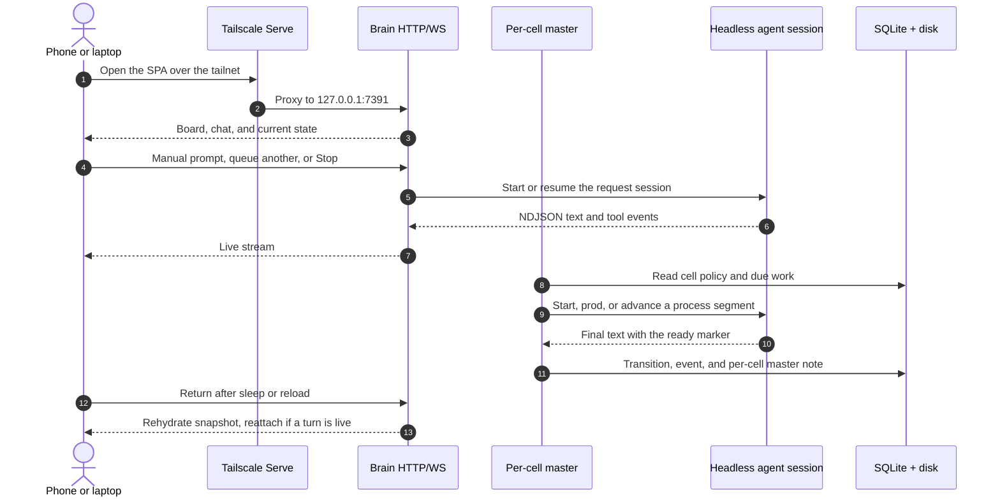
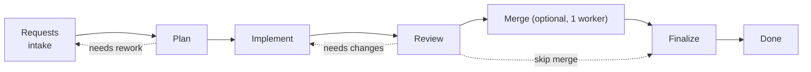

# Agent Process Segments

Formerly Sandbox Harness.

A local Node/TypeScript brain that drives headless Claude Code or OpenCode sessions
through a request workflow. One origin serves the API, an optional SPA, and the websocket, so a
single port is all a tunnel needs.

`Agent Process Segments` is the product name; a *process segment* is one stage in a
cell's pipeline.

This repository is a rebuild from the system spec at commit `f849fed`. It targets the
same data model, state machine, HTTP surface, and wire contracts.

## Intended deployment and user flow

The intended setup is one always-on Linux VPS running the headless brain and agent
processes, with the SPA exposed only through a Tailscale tailnet. A phone or laptop joins
the tailnet, opens the SPA, and sends manual prompts while the VPS keeps working. The
brain binds loopback; Tailscale Serve is the audience gate. On the VPS,
`sudo tailscale serve --bg --https=443 http://127.0.0.1:7391` publishes the loopback
port to the tailnet; only devices on that tailnet can reach it. The full install, HTTPS,
verification, and reset steps are in
[`deploy/vps.md#tailscale`](deploy/vps.md#tailscale).



Typical session flow:



The phone is a controller, not the worker. It can disconnect, reload, or queue a prompt;
the VPS keeps the session and the per-cell masters keep running. A request moves through:



The deployment runbook is in [`deploy/vps.md`](deploy/vps.md); the operator workflow is
in [`docs/08-user-workflows.md`](docs/08-user-workflows.md).

## Screens

The board is the main loop: five process segments, cell filters, agent status, and
unchecked-work markers. The drawer is the selected cell’s master: status, cron loop,
prompts, scorecard, activity, and chat. The **Usage** page totals tokens and cost by
model, cell, and request, and the **Scorecards** page collects each cell’s persisted
reports with its earlier history. The page defaults to reports generated in the last 72
hours, can widen to 24 hours, 7 days, 30 days, or all retained history, and can use a
custom local start/end date range; **Load older** pages through each cell’s history within
the selected period.

These screenshots use a staged demo board in an isolated temp database, not live data.
Regenerate them against the built SPA with the optional Puppeteer tool:

```bash
npm run build
npm install --no-save puppeteer
npx puppeteer browsers install chrome
node scripts/screenshots.mjs
```

The script exits non-zero when Puppeteer is missing, because a skipped capture is not a
refresh of the committed images. Rerun with `--allow-missing-puppeteer` only when you
mean to skip: it prints each image's timestamp so a stale capture stays visible.


The **Usage** page shows reported cost and, for turns a harness left unpriced, estimates
from the operator-maintained **Model pricing** table on the Config page. It also breaks
cost and cycle time down by cell and process segment: wall-clock time includes waiting in
the segment, active time counts only agent turns, and every revisit is summed. Reported
cost is never overwritten; a turn with neither a reported cost nor an effective price
renders as unknown or as an explicit lower bound, never as zero.

## Requirements

- Node 22.13 or newer (Vite 8 and Vitest 5 already need 22.12; ESLint 10 needs 22.13).
- `git` for per-request worktrees
- `claude` and/or `opencode` on `PATH` to run real agent turns. `APS_HARNESS` picks the
  brain default (legacy `SBOX_HARNESS` still works), and each cell can override it, so one
  brain can mix both. The core (database, workflows, HTTP, stream parsing) runs and is
  tested without an agent CLI.

## Quick start

```bash
npm ci --include=dev
npm test
npm run e2e
npm run build
APS_DB=$PWD/agent-process-segments.sqlite node src/server/dist/app.js
```

The brain's systemd unit exports `NODE_ENV=production`, and agent shells inherit it, so
a bare `npm install` or `npm ci` installs production dependencies only and
`npm run typecheck` fails with `tsc: not found`. Use the `npm ci --include=dev` above
(or `NODE_ENV=development npm ci`); a fresh `npm ci` under the inherited env prunes
`typescript`, `vite`, `vitest`, and ESLint again, so pass the flag every time. The root
`typecheck`, `test`, `lint`, `build`, `dev`, and `e2e` commands, direct workspace
`test`/`typecheck`/`build`/`dev`/`preview` invocations, and `npm run lint:js`/`lint:md`
check for the project-local binaries first and print the `npm ci --include=dev` hint if
they are missing. See the `AGENTS.md` environment-facts bullet for the sibling failures
and the `npm config get omit` check.

The brain binds `127.0.0.1:7391` unless `APS_HOST` / `APS_PORT` say otherwise. Do not
widen the bind. A tunnel is the audience gate, not the process.

The sidebar **Help** row renders the operator docs in-app from the same origin, including
the screenshots, with grouped navigation and `?help=<slug>` deep links. A GitHub icon
beside it links to the public source repository in a new tab. The brain reads the docs
from `APS_DOCS_DIR` (default `<cwd>/docs`), so ship the `docs/` directory beside the
build.

Agent turns are bounded by `APS_TURN_TIMEOUT_MS` (default ten minutes); a live but silent
child is killed and produces a visible error, and its recent stderr goes to the error log.
A harness-reported error result (for example expired authentication or a rate limit) also
fails the turn with a visible `⚠` message instead of ending silently. Bundled `aps` MCP
calls time out after `APS_MCP_TIMEOUT_MS` (default 15 seconds).

`APS_HARNESS=claude` (the default) or `opencode` sets the brain default. Each cell can
choose its own harness in the cell editor; a cell with **Brain default** inherits this
value. A request can override its cell in the request drawer; the order is request,
then cell, then brain default. A cross-harness request does not inherit the cell's model
or effort, because those ids were chosen for the other adapter. `APS_CLAUDE_BIN` and
`APS_OPENCODE_BIN` point at each adapter's binary; `APS_HARNESS_BIN` remains a legacy
fallback for the default adapter only, and the adapter-specific value wins when both are
set. The legacy `SBOX_*` names still work. `APS_DEFAULT_MODEL` sets the default harness's
fallback model. OpenCode also has an implicit `opencode-go/deepseek-v4.1-flash` default;
Claude has none unless configured. OpenCode sessions ignore `OPENCODE_CONFIG` and
`OPENCODE_CONFIG_CONTENT`: the harness strips both from the child environment and warns
once if either is set, because OpenCode layers them above the generated config and an
inline value could replace the bundled `aps` server. Put user settings in the OpenCode
config directory instead.

App settings live in `config.json` (`APS_CONFIG`) and are edited on the Config page. Each
block and notification channel validates on its own; an invalid one falls back to that
block's defaults, is reported as `settings.invalid`, and the Config page names it in a
banner until the next save. Before that save rewrites the file, the original bytes are
copied aside, and the page lists every preserved copy, including copies left by earlier
runs. The same rule applies to an invalid `process.json`, which reports
`process.backupFailed` if the copy cannot be written; the global process editor shows the
copy path after the preserving save. Preserved process copies are capped at the five
newest; older copies are pruned after a successful save, and a prune failure is logged as
`process.pruneFailed` without refusing the save.

Usage retention lives in `config.json` as `usage.retentionDays` and is editable from the
Config page. The default is 90 days; `0` keeps raw usage history forever. Before raw
`usage_events` rows are deleted, a startup/hourly job summarizes them into `usage_daily`
UTC-day rollups, then prunes the raw rows in batches. "All time" therefore includes both
the retained raw window and older daily totals. Once a day is rolled up its estimated
cost is frozen, and raising the window later cannot restore already-pruned raw detail.
Cost reported by the harness always wins; only unreported turns are estimated.

Master activity retention lives in `config.json` as `retention.masterEventsDays`, also
editable from the Config page. The default is 90 days; `0` keeps activity forever. A
startup/hourly job deletes older `master_events` rows in batches. Activity is not rolled
up: the UI reads only the latest events, and scorecard history stays in `cell_summaries`.
Rows that record a created follow-up (`action = 'followup'`) are never pruned, because
they are the deduplication key for repeated `FOLLOW-UP:` titles. Deleting a cell
immediately removes its non-followup activity and its reserved master and summary session
directories; the follow-up markers survive so detached requests keep their dedupe history.

Scorecard retention lives in `config.json` as `retention.cellSummariesDays`, also
editable from the Config page. The default is 90 days; `0` keeps scorecard history
forever. The same startup/hourly job deletes old `cell_summaries` report rows in batches,
but always keeps the newest report per cell so the drawer keeps a last-known scorecard
and the scheduler does not treat a dormant cell as never summarized. Scorecard history is
not rolled up. The Scorecards page filters by generation time, defaults to the last 72
hours, supports a custom local start/end date range, and bounds **All** and custom ranges
by this retention window.

Budget alert retention lives in `config.json` as `retention.budgetAlertsDays`, also
editable from the Config page. The default is 400 days; `0` keeps alert and delivery
history forever. The same startup/hourly job deletes acknowledged `budget_alerts` rows and
`delivered`/`failed`/`skipped` `budget_alert_deliveries` rows in batches. The current UTC
month is always kept, so a delivery row stays available as its own dedupe record and a
current-month acknowledged alert still suppresses the lower-severity alert. Pending and
in-flight deliveries are never pruned. Delivery rows snapshot the alert fields, so deleting
an alert — including retention expiring an acknowledged alert — leaves its delivery history
in place; terminal rows are bounded by the same setting and history is not rolled up.

Notification event retention lives in `config.json` as
`retention.notificationEventsDays`, also editable from the Config page. The default is
400 days; `0` keeps event delivery history forever. The same startup/hourly job deletes
`delivered`, `failed`, and `skipped` `notification_event_deliveries` rows older than the
window in batches; `pending` and `delivering` rows are never pruned. An event delivery
row is the idempotency record for its epoch-anchored coalescing window, so removing a
terminal row older than the window cannot re-send a duplicate.

Spend cap override retention lives in `config.json` as
`retention.spendCapOverridesDays`, also editable from the Config page. The default is
400 days; `0` keeps override history forever. The same startup/hourly job deletes
`spend_cap_overrides` rows by `period_start`: a UTC budget month is kept whole, and a
period is pruned only once its month starts before the month containing the cutoff. With
the default this is exactly the old 400-day budget-evaluation prune. The current month is
never pruned, and an active override can only exist in the current period, so live
snoozes are never removed. `idx_spend_cap_overrides_period` serves the scan; history is
not rolled up.

Request artifact retention lives in `config.json` as `retention.requestArtifactsDays`,
also editable from the Config page. The default is 30 days; `0` keeps request folders and
worktrees forever. A startup/hourly job deletes the whole
`$APS_DATA_DIR/requests/<id>/` workdir (transcripts, session id, generated config, and
scratch `cwd`) and removes leftover `$APS_DATA_DIR/worktrees/<id>` checkouts, but only for
`done` or `dropped` requests older than the window. Non-terminal requests, live turns,
reserved master/summary/setup/KB chats, and non-request folders are never touched. Git
branches are kept; uncommitted work in an expired checkout is discarded, as it already is
on a normal terminal dispose.

`./scripts/smoke.sh` boots the built server on a throwaway database and exercises the
main routes over a real socket.

## Upgrading from Sandbox Harness

`APS_*` is the canonical environment prefix. Every legacy `SBOX_*` variable still works
as a fallback, and `APS_*` wins when both are set. The fallback is per variable: if you set
`APS_HARNESS` while an old `SBOX_HARNESS_BIN` is still exported, the old binary path wins
for `HARNESS_BIN`; set `APS_HARNESS_BIN` (or unset the legacy value) when switching
harnesses. Filesystem defaults are also backward-compatible: if only `~/.sandbox-harness`,
`$XDG_CONFIG_HOME/sandbox-harness`, `$XDG_STATE_HOME/sandbox-harness`, or
`<cwd>/sandbox-harness.sqlite` exists, the brain keeps using it. New installs get the
`agent-process-segments` names.

A brain started with any `SBOX_*` variable still set logs one warning naming those
variables (names only, never values). Rename them to `APS_*` to clear it;
`npm run migrate:paths` moves only the filesystem defaults, not the variable names.

A blank path value such as `APS_DB=` or `XDG_CONFIG_HOME=` is ignored rather than used:
APS/SBOX path overrides fall back to a non-blank `SBOX_*` alias, XDG bases fall back to
the home defaults, and then the built-in default or legacy location is used; startup
names the variable in a warning. Values are not trimmed or expanded, so `APS_DB=:memory:`
and paths with spaces keep working.

The migration refuses to run while `agent-process-segments.service` or the legacy
`sandbox-harness.service` is active (user or system scope), while a visible process
still has the legacy data, config, state, or SQLite paths open, while a brain
answers its health endpoint, or while an opt-in brain lock is fresh. On Linux it checks
`/proc` for open file descriptors and cwds, so a foreground/dev brain or a custom unit
name is caught when the process is visible. It also requests
`http://127.0.0.1:<APS_PORT|SBOX_PORT|7391>/health`; pass
`--brain-url` to probe a container, tunnel, or another host instead. For a brain whose
HTTP port is not reachable at all, start it with `APS_BRAIN_LOCK=1` (a systemd drop-in
with `Environment=APS_BRAIN_LOCK=1`): it writes `<data-dir>/brain.lock` and refreshes it
every 10 s, and the migration treats a lock younger than 60 s as live. The brain must be
upgraded and restarted with the variable, and its data directory must be on storage
shared with the machine running the migration; `--brain-lock FILE` checks a different
heartbeat path. Stop the brain or process first; `--allow-running` bypasses all four
guards and can corrupt an open SQLite database. A brain that did not opt in, a shared
database whose data directory is not shared, a non-HTTP or non-file holder, or a process
hidden by permissions is still not detected.

To move an existing install to the new names:

1. If the brain runs in a container or on another host, so this machine's `/health`
   probe cannot reach it, set `APS_BRAIN_LOCK=1` in that brain's environment, restart
   it, and confirm `<data-dir>/brain.lock` is fresh. Its data directory must be shared
   with this machine.
2. Stop the old unit: `systemctl --user stop sandbox-harness`.
3. Preview then run the move: `npm run migrate:paths -- --dry-run` and
   `npm run migrate:paths`. The script moves the data, config, and state directories and
   the SQLite file together, including `-wal`/`-shm`; it never overwrites an existing
   destination and is safe to re-run.
4. Install the new unit: copy `deploy/agent-process-segments.service` into
   `~/.config/systemd/user/`, then `systemctl --user daemon-reload` and
   `systemctl --user enable --now agent-process-segments`.

Worktree branches created before the rebrand are named `sbox/<id>`. They stay valid
until the request finishes. The brain retires them automatically when a request reaches
`done`/`dropped` (after removing its worktree), and its startup/hourly sweep catches
terminal rows left by an older build, so an upgrade needs no operator run. The sweep
renames a lone `sbox/<id>` to `aps/<id>`, deletes the legacy ref when it is already
contained in `aps/<id>`, and repairs a stored branch whose legacy ref is gone. It never
touches a branch for a request that is not `done`/`dropped`, a branch checked out in any
worktree, or a diverged `sbox`/`aps` pair (those are logged for manual review). Orphan
`sbox/*` refs with no request row are reported but kept by default; the CLI can prune
them on request.

The same rules are available as a manual dry run or recovery command:

```bash
npm run build                       # the command runs from dist
npm run migrate:branches -- --dry-run
npm run migrate:branches -- --apply
# optional: also retire orphan refs that have no request row
npm run migrate:branches -- --prune-orphans --dry-run
npm run migrate:branches -- --apply --prune-orphans
```

The command renames a lone `sbox/<id>` to `aps/<id>`, deletes the legacy ref when it is
already contained in `aps/<id>`, and repairs a stored branch whose legacy ref is gone.
It never touches a branch for a request that is not `done`/`dropped`, a branch checked
out in any worktree, or a diverged `sbox`/`aps` pair (those are reported for manual
review). Orphan `sbox/*` refs with no request row are reported but kept by default; add
`--prune-orphans` to retire them. With `--apply`, the orphan tip is first archived as
`refs/sbox-pruned/<suffix>-<sha>`, then the branch is deleted, so no commits are lost.
Checked-out orphans are skipped, and a ref is orphaned only when its id has no request
row at all. The command opens the live database without migrating or reconciling it and
keeps the database and sidecars owner-only. A dry run opens it read-only at the SQLite
level, so it does not recover or checkpoint the WAL; `--apply` opens it read-write for
the branch-row updates. List backups with
`git for-each-ref refs/sbox-pruned/` and restore one with
`git branch <name> <ref>`. Pass `--repo DIR` to limit the run and `--db FILE` to point
at a non-default database.

Request workdirs created before the owner-only change keep their old modes until they
are written again. After upgrading and restarting, preview and apply the one-time repair:

```bash
npm run build
npm run repair:permissions              # preview
npm run repair:permissions -- --apply   # tighten old request workdirs
npm run repair:upgrades                 # preview old upgrade evidence
npm run repair:upgrades -- --apply      # tighten old upgrade run dirs/snapshots
```

The command only tightens the known `requests/` artifacts (`requests/`, each session
dir, `cwd/`, `opencode/`, `session.json`, `transcript.json`, `mcp-config.json`, and
`opencode/opencode.json`). It never rewrites transcripts, never recurses into `cwd/`
checkouts, and is safe while the brain runs.

Upgrade run directories and snapshots from an older version are repaired the same way:
`npm run repair:upgrades` previews and `npm run repair:upgrades -- --apply` sets
`~/.aps-cutover/upgrades` and each run directory to `0700` and each `db-backup.sqlite` to
`0600`. It never follows symlinks, deletes anything, opens the database, or touches
cutover runs.

Do not install the new unit before migrating: it sets explicit `APS_*` paths, so the
brain would open empty new locations. Existing worktrees move with the data directory; if
git reports them at the old path, run `git worktree repair` in the target repo or remove
and recreate them.

Rollback is manual: an older binary reads only `SBOX_*`, so a rollback unit or drop-in
must point `SBOX_DB`, `SBOX_DATA_DIR`, `SBOX_CONFIG`, and the other path variables at the
migrated locations.

On a running host, especially one whose brain is orchestrating its own cutover, use
`npm run cutover:vps -- --dry-run` and then `--detach` instead of the manual sequence.
The script drains active turns, moves the clone and paths, repairs worktrees, verifies
the new unit, and rolls back in place on failure. See
[`deploy/vps.md`](deploy/vps.md#cutting-over-a-live-self-hosted-brain).

Each cutover leaves evidence and a rollback backup under `~/.aps-cutover/runs/`. A real
cutover prunes older runs before it starts and after it finishes; it keeps the newest 10
runs and anything modified in the last 30 days by default, plus the current run, the
`latest` target, and the newest successful rollback point. Pass `--no-prune` to opt out.
You can still prune by hand with `npm run prune:cutover -- --dry-run` and then
`npm run prune:cutover`; see
[`deploy/vps.md`](deploy/vps.md#prune-cutover-run-directories-and-backups).

Once the host is on the Agent Process Segments names, upgrade it with
`npm run upgrade:vps -- --dry-run` and then `--detach` instead of the manual pull/build.
The script drains active turns, snapshots the database and `dist`, installs dependencies
when the lockfile moved, rebuilds, restarts, verifies the new build, and restores the
previous commit and build in place when anything fails. See
[`deploy/vps.md`](deploy/vps.md#upgrade-a-live-self-hosted-brain).

Each upgrade leaves evidence under `~/.aps-cutover/upgrades/` and prunes older runs
automatically after every terminal state. You can also prune by hand with
`npm run prune:upgrades -- --dry-run` and then `npm run prune:upgrades`; it keeps the
newest 10 runs, anything modified in the last 30 days, `upgrades/latest`, the newest
successful run, and incomplete runs for a 7-day grace window. Pass `--keep-runs 5` to
match the automatic pass. Deleting a run also deletes its database snapshot and previous
build trees, so preview first. See
[`deploy/vps.md`](deploy/vps.md#prune-upgrade-run-directories).

## Spend budgets

The Config page edits an **overall monthly budget** and warning percentage; each cell has
an optional monthly budget in its editor. Budgets use the UTC calendar month. Alerts use
harness-reported `cost_usd`; unpriced turns are shown as unknown or a lower bound, never as
zero. Crossing the warning percentage or the budget creates a durable alert shown in a
dismissible banner; acknowledging it silences that alert for the month.

Each scope can also opt into **pause on exceeded**. A hard cap counts reported plus
estimated cost, pauses new work at the cap, and stops the turns already running in that
scope. Overall pauses every new agent turn and stops every live one; a cell pause affects
only that cell's request, master, and summary work. Raise or clear the budget, turn the
option off, or wait for the UTC month to roll over to resume. Acknowledging an alert does
not override a pause.

The cap can additionally opt into **strict unknown cost**. Strict mode pauses the scope
while any turn in the current UTC month has neither a reported nor an estimated cost, even
when the known lower bound is below the budget. Add a matching effective-dated price,
clear the budget, turn strict mode off, or wait for the next month to resume; raising the
budget only helps a reached cap. A turn with no reported model cannot be priced after the
fact. A ledger read failure still fails open. The same cap spend and pause state are shown
on the Config and Usage pages and in the app banner, with a distinct unknown-cost reason.

A stopped turn is not lost: its partial transcript is saved, the transcript records why it
stopped, and the harness session stays on disk, so sending again after the pause clears
continues from the same session. Nothing is replayed automatically. Spend is recorded when
a turn completes, so one long turn can still overshoot the cap before the next crossing is
observed. The Usage card and banner share one budget poll; the card keeps its last good
status when a refresh fails and offers Retry when budget status cannot be loaded. A
snooze, an end-override, a budget save on the Config page, a cell budget/pause save in
the cell editor, or deleting a cell refreshes that shared poll immediately, so the banner
and the status rows agree without waiting for the next tick.

A paused scope can also be **snoozed** for 15 minutes up to the rest of the UTC month. An
overall snooze admits every new turn; a cell snooze admits only that cell. Snoozing never
raises the budget or clears an alert: the banner and status rows keep showing the cap and
the override expiry until it is ended early or expires, when the pause resumes. Granting a
snooze does not stop or resume anything: turns already stopped stay stopped, and a live
turn keeps running while the override is active, so spend can overshoot during the window.
Ending a snooze immediately re-pauses the scope and stops its live turns; an expiry is
enforced by the next budget check (within 60 seconds). When the **Spend cap overrides**
event route is enabled, a grant or extension while the cap still blocks work and an
expiry that leaves the scope blocked again are delivered to the configured webhook/email
channels. A revoke is not notified, and an expiry is observed by the next budget check
(up to 60 seconds later). A notification never raises a budget, clears an alert, or
changes pause state.

The Config page's **Spend cap override history** card is a read-only record of retained
snoozes across UTC months. It shows the scope, state (`active`, `revoked`, or `expired`),
budget period, grant time, any later-expiry extensions, final expiry, revocation time, and
the optional note, with scope/state filters and pagination. It is an audit view: it does
not raise a budget, clear an alert, change pause state, or resume a stopped turn. History
follows the Config page's **Spend cap override retention** window (default 400 days;
`0` keeps it forever), pruned by whole UTC budget month so the current month is always
kept; an active row means its window is still open, not that the scope is currently
paused or still configured as a hard cap. There is no operator identity or per-event
audit; the optional note is the only context recorded.

## Alert delivery

The Config page's **Alert delivery** card sends each unacknowledged current-month alert
once to an opt-in HTTPS webhook. Formats are `json` (the full event, signed with
HMAC-SHA256), `slack` (`{ "text": … }`), and `discord` (`{ "content": … }`). Delivery is
durable: `budget_alert_deliveries` stores one row per alert and destination, retries
transient failures at 60 s, 5 min, 30 min, and 2 h up to five attempts, honors
`Retry-After`, and never blocks budgets, turns, or the in-app banner. Acknowledging an
alert, changing the budget or threshold, or changing the destination skips pending
deliveries. When a signing secret is set, every webhook request carries the timestamped
`X-APS-Signature-V2: t=<ms>,v2=<hex>` over the exact raw body plus that timestamp; the
signature covers the body for every format, and `X-APS-Timestamp` is always sent. The
legacy body-only `X-APS-Signature` header is no longer sent. Slack and Discord receivers
ignore signature headers. See
[Verify webhook signatures](docs/08-user-workflows.md#verify-webhook-signatures) for a
runnable V2 receiver, the freshness window, the constant-time check, and the
response/retry and replay rules. The [Webhook payloads](docs/14-webhook-payloads.md)
reference lists every JSON field, discriminator, and dedupe id for budget alerts and
event notifications.

The **Slack alerts** and **Discord alerts** cards add authenticated bot delivery. Paste a
bot token, add one or more channel IDs, choose a default destination, and optionally route
specific cells to specific channels. Overall alerts go to the default; a cell with a route
uses it and otherwise falls back to the default. The bot must already be invited to the
channel (Slack needs `chat:write`; Discord needs View Channel and Send Messages). Chat
messages include the alert sentence, threshold, UTC month, unpriced-turn count, and a
Usage link when `APS_BRAIN_URL` is a non-loopback URL. Slack and Discord tokens are
redacted from the API and never logged.

The independent **Email delivery** card adds SMTP as a channel. Set a host, port, optional
username and password, `From` address, and up to ten recipients. Port 465 uses implicit
TLS; other ports require STARTTLS for any non-loopback host. Webhook, email, and chat rows
share the same outbox and retry schedule but dedupe per destination, so disabling or
re-pointing one channel never cancels the others. A saved password or bot token is
redacted from the API and only cleared when the operator asks.

The independent **Event notifications** card can send four operational event kinds to the
same webhook and email channels: **failed request turns** (a harness error result, non-zero
agent exit, or timeout), **master errors** (a failed master turn or scheduler cycle),
**scorecard failures** (a failed summary generation), and **spend cap overrides** (a grant
or extension while the cap still blocks work, or an expiry that leaves it blocked again).
Each event kind has its own webhook and email checkboxes; the channel must also be enabled
above. Event bodies carry ids, the request title/state or cell, and a classification only,
never a prompt, transcript, diff, stderr block, or raw error text. A cap-stopped scorecard
is a pause, not a failure. Repeat failures with the same signature are coalesced inside a
configurable window (default 60 minutes, one UTC hour; allowed 1–1440) per channel.
Optional **cell routes** limit an event kind/channel to specific cells; with no route the
channel follows the all-cells default. An overall spend-cap override has no cell, so routes
do not filter it. Narrowing a route skips pending rows for excluded cells, and enabling a
route or widening the window never backfills old events. Override events dedupe by
override, change, and expiry rather than the failure window. Event deliveries use the same
durable retry, signing, timeout, and destination-rotation rules as budget alerts.

`GET /api/notifications/status` shows per-channel and per-destination queue, failure, and
last-delivery state, plus aggregate and per-kind event counts.
`POST /api/notifications/{webhook,email,slack,discord}/test` sends a
synthetic test event without writing alert or delivery rows; chat tests accept an optional
`channelId` and otherwise use the default destination.

The **Delivery history** card lists recent webhook, email, and chat attempts for budget
alerts and operational events newest first, with channel, type, subject, status, attempts,
next attempt, and a sanitized error. Filter by type, channel, or status; each page holds
ten rows. Types are budget alerts, failed turns, master errors, scorecard failures, and
spend cap overrides. Budget rows keep the alert scope/threshold/spend snapshot; event rows show only
the safe event title/text, source/reason, ids, cell name, and occurrence time, never the
raw payload. **Resend** is offered only for `failed` or `skipped` rows. Budget rows
require an unacknowledged alert in the current UTC month and a channel/destination that
are still enabled and configured; event rows require their kind/channel route plus the
channel to be enabled and configured, otherwise resend returns `409 event_disabled`. A
resend reuses the outbox row,
re-stamps it to the current destination and format, resets the attempt count, and queues
it for the next flush; delivered rows are immutable. History is read-only. Budget rows
are pruned under `retention.budgetAlertsDays` (default 400 days; the current UTC month is
always kept and pending or in-flight rows are never pruned); event rows follow
`retention.notificationEventsDays` (default 400 days; `0` keeps them forever, and pending
or in-flight rows are never pruned). A budget row remains after its alert is deleted (clearing a
budget, changing its threshold, deleting a cell, or retention expiring an acknowledged
alert); it becomes history-only and cannot be resent. `GET /api/notifications/deliveries`
filters by `source` (`budget|event`) or `kind` (`turn.failed|master.error|summary.failed|spend.override`) and
`POST /api/notifications/deliveries/:id/resend` backs the card for both outboxes.
Fan-out to several destinations per scope and interactive acknowledgement remain separate
backlog items.

## Docs

- `docs/01-system-spec.md` the governing contract
- `docs/02-status.md` built versus not built, route list, deviations
- `docs/03-decisions.md` why this rebuild chose what it chose
- `docs/04-design-liberties.md` autonomous choices to review
- `docs/05-plan.md` current feature plan and task list
- `docs/06-refactor-audit.md` duplication/bug audit and deferred cleanup
- `docs/07-process-segments.md` process.json contract and automation rules
- `docs/08-user-workflows.md` end-to-end operator workflows
- `docs/09-backlog.md` scoped follow-ups (chat fan-out, webhook/email routing, interactive
  ack, hard-cap refinements, pricing maintenance)
- `docs/10-error-log.md` error-only NDJSON log: path, format, rotation, sites
- `docs/11-skills.md` chat slash-command and skill discovery
- `docs/12-terminals.md` server-owned PTY sessions, reattach, and close
- `docs/13-cell-wizard.md` cell creation chat and policy setup
- `docs/14-webhook-payloads.md` receiver-facing webhook bodies, discriminators, and ids
- `deploy/vps.md` VPS, systemd, and Tailscale runbook
- `AGENTS.md` handoff: environment traps, invariants, extension recipes, next units

## Layout

```text
src/server/src
  app.ts              entry: open db, build repos + engine, listen
  config.ts           every path and port, env-overridable
  db.ts               schema, idempotent column migrations, boot reconcile
  domain/request.ts   states, transition table, entities, transcript types
  domain/sessions.ts  reserved KB/master session ids, per-cell master sessions
  domain/budget.ts    pure budget contract: settings, UTC month, status, alert types
  requests/           RequestRepository: CRUD, edit, guarded transitions
  cells/              CellRepository + in-memory cell wizard drafts; per-cell policy,
                      interval, concurrency cap, model/effort defaults, auto-compaction
                      threshold, and budget
  usage/              ledger queries, budget status/alerts, and durable webhook/email/chat delivery
  kb/                 KbRepository: one entry per request, ranked literal search
  http/server.ts      Fastify routes, zod validation, NDJSON streaming, SPA vend
  clarify/engine.ts   one persistent agent session per request, buffered live turns
  clarify/harness.ts  harness seam: session prep, spawn, parser, model probe
  clarify/harnesses/claude.ts    claude CLI, merged MCP config, allowlist
  clarify/harnesses/opencode.ts  opencode CLI, JSONC user config merge, per-turn runs, session resume
  clarify/harnesses/plugin-assets.ts  plugin skills/commands -> OpenCode config
  clarify/stream.ts   pure claude stream-json parser (no process, no disk)
  clarify/transport.ts  the AgentProcess interface harnesses implement
  clarify/prompts.ts  seed, dispatch, finalize, and KB briefs
  clarify/worktree.ts per-request git worktree on branch aps/<id> (legacy sbox/<id> reused)
  clarify/models.ts   model catalog with a cached probe and harness fallback
  maintenance/legacy-branches.ts  safe sbox -> aps decisions shared by dispose, sweep, CLI
  maintenance/legacy-branch-sweeper.ts  startup/hourly cleanup for leftover terminal refs
  settings.ts         XDG scheduler settings, zod validation, atomic write
  docs/service.ts     explicit Help manifest, Markdown reads, screenshot assets
  process/            six segment definitions (incl. Merge), defaults, store, follow-up parser
  master/events.ts    master event log (start, prod, advance, followup, cycle, skip)
  master/service.ts   one master bucket: segments, follow-ups, advancement, cell chat
  master/scheduler.ts per-cell timers, per-cell manual run, one dispatch cycle per cell
  summary/            per-cell scorecard policy, deterministic stats, read-only generation,
                      polling scheduler, persisted report history
  mcp/server.ts       stdio `aps` MCP server exposing bundled board/KB/draft tools, proxied to the API
  mcp/identity.ts     shared MCP server key, handshake version, tool prefix,
                      and allow-list helper
  skills/catalog.ts   OpenCode/Claude skill discovery, global + project + request repo
  usage/types.ts      pure usage contract shared with the SPA
  usage/repository.ts usage_events writes plus merged raw/daily queries
  usage/sql.ts        shared price/estimate SQL and raw+daily query source
  usage/rollups.ts    UTC-day rollup writer and watermark
  usage/retention.ts  chunked rollup-then-prune job
  pricing/types.ts    pure effective-dated price contract and estimate helper
  pricing/repository.ts model_pricing list/create/remove plus effective lookup
  logging/errors.ts   structured error-only NDJSON log with size rotation
  terminal/service.ts server-owned PTY sessions with scrollback + attach/detach
  plugins/manager.ts  install, strip hooks/mcp, list, remove, slash-command discovery
src/web
  vite.config.ts      dev server, proxying /api and /ws to the brain
  src/main.tsx        mounts the app and turns on the dark class
  src/App.tsx         shell: nav, cell bar, board, usage page, detail drawer, Help route
  src/HelpPanel.tsx   full-height docs overlay: nav rail, markdown, on-this-page
  src/docs.ts         help slugs, relative link/image rewriting, heading anchors
  src/Board.tsx       six columns, drag-to-advance, agent badges
  src/UsagePage.tsx   overall/cell usage dashboard, reported/estimated cost chart
  src/ScorecardsPage.tsx per-cell persisted scorecard reports with history
  src/Scorecard.tsx   shared markdown renderer for one report
  src/usageFormat.ts  token/cost formatters with exact/≈/≥ cost distinction
  src/RequestDetail.tsx  edit fields, guarded transitions, kickoff streams, usage, digest
  src/ClarifyChat.tsx    per-request chat, reattach on mount
  src/Thread.tsx      assistant-ui primitives, markdown, tool cards
  src/runtime.ts      useExternalStoreRuntime over React-owned messages
  src/Composer.tsx    custom input with slash-command autocomplete
  src/ConfigPage.tsx  scheduler, budgets, webhook/email/chat delivery, process editor, pricing, policy
  src/BudgetBanner.tsx dismissible warning/exceeded spend alerts
  src/ProcessEditor.tsx structured per-segment controls
  src/CellModal.tsx   cell creation/edit flow with a process snapshot and budget
  src/MasterDetail.tsx first-class master drawer: status, prompts, activity, chat
  src/TerminalPanel.tsx desktop-only maximizable xterm/PTY drawer
  src/ui.tsx          hand-rolled shadcn-style kit
.github
  workflows/ci.yml         published CI workflow (runs on main pushes and PRs)
deploy
  agent-process-segments.service  systemd user unit for the brain
  vps.md                   install, tunnel, update, and restart runbook
  ci-workflow.yml          CI workflow source template (copied to .github/workflows/ci.yml)
```

## API

All JSON except the NDJSON streams. See `docs/02-status.md` for the route list and
what is not built yet.

## Tests

`npm test` runs 1324 vitest cases: 1016 server cases across 56 files (state machine,
migrations including the index ordering fix on a legacy database, repositories, both
stream parsers, usage event capture and aggregation, effective-dated pricing and
estimation, usage rollups and activity retention, scorecard retention, cell-delete
activity and session cleanup, request-artifact and worktree retention, cutover run
retention, engine turns over a fake harness, worktree isolation against a real git repo,
the MCP tool surface, harness config/MCP/plugin mapping, model probing, the plugin
manager against real git clones, process definitions/store/follow-ups, per-cell
policies/tickers/limits/auto-compaction, the generic master pipeline, segment caps and
merge, turn watchdogs/stderr, scorecard stats/generation/scheduling, budget
status/alerts/hard caps and in-flight cap stops including strict unknown cost,
time-boxed overrides and their read-only history, webhook/email/Slack/Discord delivery
dedupe/retry/signing with an
injected sender, delivery history and resend, docs manifest/traversal/HTTP, error-log
format/rotation, skill discovery, terminal session lifecycle, and the HTTP API over a
real socket) and 308 web cases across 28 files (shared contract re-exports, NDJSON
client, chat folding, the cross-tab and crash-safe chat queue claim, slash/skill
resolution, request-form mapping, docs helpers and Help overlay, documentation links and
Help anchors, the source link, board,
create modal, composer, cell bar, cell creation, config/process and pricing editor,
budget and alert-delivery cards including chat bot routing, delivery history, and
spend-cap overrides, budget banner, master detail and scorecard, the usage page and
formatters, the scorecards page, and the app shell with the drawer and chat mounted
under jsdom).

Those totals are collected Vitest cases, so skipped cases still count toward them.
When a case or test file is added or removed, refresh all five numbers from a clean
`vitest run` in `src/server` and `src/web` and use the `Tests` line (passed + skipped).
Do not derive the server total from `vitest list --json` alone: it omits cases skipped at
runtime, such as the root-only harness permission test, so it reports one fewer case
than the suite runs. The totals are quoted identically in this file, `AGENTS.md`, and
`docs/02-status.md`, and `src/server/test/doc-counts.test.ts` fails when they drift
apart.

`npm test` also runs `npm run test:e2e-env`, a `node:test` guard for the proof scripts: the
environments they hand to their children, the missing-Puppeteer policy, and the interrupt
cleanup coordinator; it is not counted in the vitest totals.

Server test fixtures live under one `sbox-tests-*` root per test file in the OS temp
directory and that root is removed when the file finishes, including after a failing
assertion. A crashed or killed run can still leave a root behind; run
`node scripts/clean-test-tmp.mjs` to preview stale `sbox-*`/`aps-*` temp dirs older than
an hour, and add `--apply` to delete them.

`npm run lint` runs ESLint 10 from one flat config (`eslint.config.mjs`) over the
TypeScript sources, `scripts/**/*.mjs`, the root and web config files, and `.opencode`
plugin sources when present, with the `react-hooks` `recommended-latest` preset for the
SPA. It also runs `bash -n` and `shellcheck --severity=warning` over `deploy/*.sh` and
`scripts/*.sh`, `actionlint` over `deploy/ci-workflow.yml` and
`.github/workflows/ci.yml`, and the unit gate over
`deploy/agent-process-segments.service`, and fails on any warning, shell syntax
error, workflow error, or unit diagnostic. It runs `markdownlint-cli2` over every tracked
`*.md` (the root docs, `docs/`, `deploy/vps.md`, and `.opencode/skills`) with a
120-column prose cap and tables, fences, and headings exempt from MD013, and a Markdown
finding fails it too. Link and anchor correctness is a test rather than a lint step:
`npm test` (or `npm run check:docs` alone) resolves every local `*.md` link, image, and
`#fragment` against the Help heading ids and fails on a broken one, without fetching
external URLs. The unit gate runs `systemd-analyze verify`, treats a diagnostic
naming the unit as fatal because `systemd-analyze` exits 0 for unknown keys and invalid
values, asserts the reviewed sandboxing directives, and fails when the offline
`systemd-analyze security` exposure exceeds 5.5. The security review needs systemd 250 or
newer; below that the Linux gate fails rather than skipping. The shell checks need
`bash`, which the deploy runbooks already require, plus `shellcheck`
(`apt-get install shellcheck` or `brew install shellcheck`). actionlint is a system tool
too: install it with `brew install actionlint`, your package manager, or the pinned
v1.7.12 release binary CI uses (CI verifies the release SHA-256 before running it);
`systemd-analyze` ships with systemd on Linux. The unit gate skips with a visible line
on non-Linux hosts and fails on Linux when `systemd-analyze` is missing.

`node scripts/mcp-smoke.mjs` is the stronger check: it boots the built brain, spawns
the built MCP server over stdio, proves a tool call persists through the API into
SQLite, and fails if any round trip or persisted value does not match. Its brain env
pins the XDG config/state bases and `OPENCODE_CONFIG_DIR` under the temp dir, so the
skill catalog cannot read host config.

`node scripts/claude-mock-smoke.mjs` verifies the real Claude Code binary against a local
mock Anthropic API: a streamed turn, an MCP tool round-trip, resumed session, and a
probed model catalog. It runs with a hermetic child env and pins the legacy `SBOX_*`
aliases on purpose. It selects its own binary from `--claude-bin <path>` or
`CLAUDE_MOCK_SMOKE_BIN`, then `claude` on `PATH`; inherited `APS_*`/`SBOX_*` settings are
ignored. The chosen file must answer `--version` with "Claude Code": a wrong explicit
choice fails the run, and a wrong `claude` on `PATH` is skipped with the rest of the
binary search. It skips when no qualifying binary is available.

`npm run e2e` boots the built brain on a temp DB with a deterministic mock Claude CLI,
creates a dedicated `E2E` cell, and exercises clarify → dispatch → master prod/review →
follow-up creation → per-cell master chat → concurrency cap → finalize. It never indexes
into the KB; the suite asserts the KB stays empty. It uses no live data and cleans up the
temp directory. The JavaScript proof scripts build their child env with
`scripts/e2e/env.mjs` (`scrubEnv` + `buildPinnedEnv`): host `APS_*`/`SBOX_*` settings and
`ANTHROPIC_*`/`CLAUDE_*`/`OPENAI_*` credentials are dropped, then each script's paths,
port, harness, and mock binary are pinned. The Claude and MCP smokes keep deliberate
`SBOX_*` pins so the legacy aliases stay under test; the MCP smoke also pins
`XDG_CONFIG_HOME`, `XDG_STATE_HOME`, and `OPENCODE_CONFIG_DIR` under its temp dir. A
shell that exports harness overrides therefore still exercises the mock.

CI runs the E2E, MCP stdio, and Claude mock smoke steps with hostile overrides exported
(`SBOX_HARNESS_BIN=/bin/false`, `APS_HARNESS=opencode`, `APS_CLAUDE_BIN=/bin/false`,
`APS_BRAIN_URL=http://127.0.0.1:1`, `APS_REQUEST_ID=hostile-request`, and similar), so a
regression that lets the host env through fails the build.
`src/server/test/ci-workflow.test.ts` keeps the E2E and MCP steps' env blocks identical
and fails if the published `.github/workflows/ci.yml` drifts from the template.
Reproduce it locally after building:

```bash
npm run build
env SBOX_HARNESS_BIN=/bin/false APS_HARNESS=opencode APS_TURN_TIMEOUT_MS=1 \
  node scripts/e2e.mjs
env SBOX_HARNESS_BIN=/bin/false APS_HARNESS=opencode APS_BRAIN_URL=http://127.0.0.1:1 \
  APS_REQUEST_ID=hostile-request node scripts/mcp-smoke.mjs
env SBOX_HARNESS_BIN=/bin/false APS_HARNESS=opencode APS_CLAUDE_BIN=/bin/false \
  APS_DB=/tmp/hostile-claude-smoke.sqlite node scripts/claude-mock-smoke.mjs
```

`node scripts/ui-smoke.mjs` is an optional real-browser check. Install Puppeteer first
(`npm install --no-save puppeteer && npx puppeteer browsers install chrome`), point
`UI_BASE` at a running brain, then run it. It creates and drops a request, opens the
drawer/chat, opens Help and Config, verifies that the Help Getting started page renders
its Mermaid diagram as an SVG, and fails on page errors. `UI_MOBILE=1` runs the
same flow at 390×844 with the off-canvas menu checks. It fails when Puppeteer is
absent; pass `--allow-missing-puppeteer` to skip it deliberately (the skip prints
`SKIPPED` and is not a pass).

`node scripts/screenshots.mjs` uses the same optional Puppeteer install to rebuild
`docs/screenshots/board.png` and `docs/screenshots/master.png` from a staged temp board.
It needs `npm run build` first and exits non-zero when Puppeteer is absent; pass
`--allow-missing-puppeteer` to skip the capture deliberately (it prints the current
image timestamps). The spawned server and the capture browser both get a pinned
environment from `scripts/e2e/env.mjs`, so inherited `APS_*`/`SBOX_*` settings,
credentials, `LANG`, and `TZ` cannot change the staged board; `npm run test:e2e-env`
guards the pins. Interrupting the run with `SIGINT` or `SIGTERM` closes the capture
browser, stops the spawned brain, and removes the temp board.

CI (`.github/workflows/ci.yml`, published byte-for-byte from the
`deploy/ci-workflow.yml` template) runs an `npm audit --omit=dev --audit-level=high`
runtime dependency gate, lint, typecheck, the full test suite, the build, the E2E API
workflow, and the HTTP/MCP smoke scripts on pushes to `main` and on pull requests. It
also re-runs the web suite with `NODE_ENV=production`, exercising the inherited-production
React-resolution path. Edit the template, copy it over the published file, and let
`src/server/test/ci-workflow.test.ts` fail if the two diverge.
